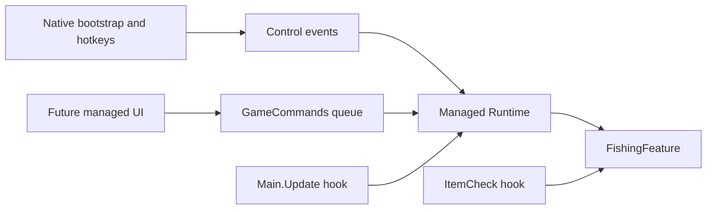

# A compact framework for more features

## What needed to change

`Entry.cs` owned startup, events, fishing, patches, and logging. Detachment depended
on `Player.ItemCheck`, so lifecycle work could stall outside a world. Adding tools
there would make every feature depend on fishing. The injector also used a personal
absolute path and ignored most failures.

## The new boundaries



- **`Runtime` owns the session.** It installs hooks, processes controls, drains
  commands, and shuts down. Startup publishes the instance only after initialization.
- **Hooks adapt game callbacks.** `Main.Update` handles lifecycle work even at the
  menu. `ItemCheck` keeps fishing at its original timing. Features own their state.
- **`CommandQueue<T>` is the threading boundary.** It accepts at most 64 pending
  actions and runs at most 16 per update. Exceptions are logged individually;
  commands posted during a batch wait for a later batch. Keep each action short.
- **Cleanup is explicit.** Detachment closes the queue, disables fishing, and removes
  this project's patches before acknowledging the native bridge. Fishing restores
  temporary input in a [Harmony finalizer](https://harmony.pardeike.net/v2/articles/patching-finalizer.html),
  preserving exceptions from Terraria. Its per-call state is now a struct to avoid
  an allocation on every item check.

The native entry point now only starts the bootstrap worker. The injector uses a
relative default path, Unicode paths, checked operations, matching process
architecture, and scoped resource cleanup. Game reference paths are configurable;
project intermediates and architecture outputs are separated.

## Adding inventory editing or teleporting

Put game operations in a concrete class under `Features/`. Add it to the managed
project's explicit compile list. Give long-lived features a runtime-owned instance
and explicit shutdown; one-shot operations can simply be methods. Introduce a common
feature interface when multiple features actually need the same lifecycle.

From managed UI code, submit work through the existing API:

```csharp
bool queued = GameCommands.TryEnqueue(player =>
    Log.Write("Selected slot: " + player.selectedItem));
```

Capture input values, resolve game objects inside the action, and validate slot
bounds, item IDs, coordinates, and multiplayer synchronization there. Acceptance
does not guarantee execution: menu, pause, death, character changes, and shutdown
invalidate pending work. Session identity prevents late submissions from an old
session applying after resume. Publish copied snapshots for UI reads too.

## Extending the ImGui menu

The menu now uses ImGui's native core/Win32 input backend and a managed XNA renderer.
`Overlay.cpp` owns tabs and console history; `XnaUiRenderer.cs` submits meshes to
Terraria's graphics device. `Overlay.cs` owns graphics resources and native shutdown.

A managed UI can call `GameCommands` directly. Native feature controls will need
typed command/snapshot endpoints alongside the existing rendering/logging ABI.
The current menu contains no gameplay controls. Keep render callbacks focused on
intent and snapshots; game updates apply changes. See [the menu guide](imgui-menu.md).

## How to learn from this

Trace F6 from native event to runtime to fishing, then trace F7 through cleanup.
Read the queue tests and predict what survives a failure or shutdown. Implement
one validated command before adding its UI. Ask who owns each resource, which
thread may touch it, and what happens when its session ends. These questions lead
to useful boundaries without requiring a large framework.
